# Hướng dẫn Cơ sở Dữ liệu VeggieLife (Database-First) & Schema ERD

Tài liệu đặc tả kiến trúc cơ sở dữ liệu vật lý, sơ đồ thực thể quan hệ (**Schema ERD**) và hướng dẫn tự động hóa khởi tạo CSDL **VeggieLife** (**41 bảng thực thể chuẩn 3NF, 343 thuộc tính**). 

Tài liệu này được thiết kế để **bất kỳ thành viên nào (sử dụng Windows, macOS hay Linux/Docker) đều có thể dựng thành công CSDL hoàn chỉnh 100% chỉ sau một vài câu lệnh**.

---

## 1. Nguyên tắc cốt lõi (Database-First là tối thượng)

1. **Chuẩn mực 1 chiều (SQL $\rightarrow$ Entity C#):** Mọi sự thay đổi về cấu trúc bảng, tên cột, khóa ngoại hay chỉ mục đều phải thực hiện trực tiếp tại thư mục `database/schema/` bằng mã DDL SQL. **Tuyệt đối không chỉnh sửa thủ công các file POCO C#** trong `src/VeggieLife.DAL/Entities/`.
2. **Tính lũy thừa (Idempotency):** Toàn bộ 45 tệp DDL và các script nạp Master Data đều có cơ chế kiểm tra `IF NOT EXISTS` / `MERGE`. Việc chạy lại kịch bản nhiều lần trên cùng một database không bao giờ phát sinh lỗi trùng lặp (Duplicate Key / Object Exists).
3. **Quyết định kiến trúc D100 (`VenueMenuItems`):** Bảng số 34 (`VenueMenuItems`) vẫn được tạo đầy đủ 7 cột trong CSDL để đảm bảo khớp tài liệu đặc tả SRS FA25 (343 cột), tuy nhiên dự án thống nhất loại bỏ tính năng thực đơn quán ăn trong phạm vi MVP (không viết DTO hay Controller cho bảng này).
4. **Tiêu chuẩn nghiệm thu:** Sau khi dựng xong, chạy script kiểm tra `verify_schema.sql` bắt buộc phải trả về:
   ```text
   >>> KẾT QUẢ NGHIỆM THU: [PASS] ĐẠT 100% TIÊU CHÍ (41 BẢNG, 343 CỘT)
   ```

---

## 2. Sơ đồ Thực thể Quan hệ (Schema ERD - Crow's Foot)

Kiến trúc CSDL VeggieLife được chia làm **6 Cụm phân hệ nghiệp vụ (Clusters)** liên kết chặt chẽ:

```mermaid
erDiagram
    %% CLUSTER 1: QUẢN TRỊ TÀI KHOẢN, SỨC KHỎE & HỘI VIÊN
    Users ||--o| HealthProfiles : "có hồ sơ"
    Users ||--o{ UserWeightHistory : "theo dõi cân nặng"
    Users ||--o{ UserAllergies : "khai báo dị ứng"
    Allergens ||--o{ UserAllergies : "thuộc nhóm dị ứng"
    Users ||--o{ PaymentTransactions : "thanh toán"
    SubscriptionPlans ||--o{ PaymentTransactions : "gói đăng ký"
    Users ||--o{ AIQuotaLogs : "ghi nhận token"
    Users ||--o{ Surveys : "làm khảo sát"
    Users ||--o{ AuditLogs : "ghi vết kiểm toán"

    %% CLUSTER 2: MẠNG XÃ HỘI, BÀI ĐĂNG, VIDEO & TƯƠNG TÁC
    Users ||--o{ Posts : "đăng bài"
    Posts ||--o| Videos : "đính kèm video"
    Videos ||--o| VideoTranscripts : "phiên âm STT"
    Posts ||--o{ Comments : "nhận bình luận"
    Users ||--o{ Comments : "viết bình luận"
    Posts ||--o{ Votes : "nhận tương tác vote"
    Users ||--o{ Votes : "thực hiện vote"
    Users ||--o{ ViolationReports : "báo cáo vi phạm"
    Posts ||--o{ ViolationReports : "bị báo cáo"

    %% CLUSTER 3: CÔNG THỨC CHAY, THỰC ĐƠN, NGUYÊN LIỆU & ĐI CHỢ
    DietarySchools ||--o{ Recipes : "thuộc trường phái"
    FoodCategories ||--o{ Recipes : "phân loại món"
    Users ||--o{ Recipes : "sáng tạo công thức"
    Posts ||--o| Recipes : "gắn liền bài đăng"
    Recipes ||--o{ RecipeIngredients : "chứa nguyên liệu"
    Ingredients ||--o{ RecipeIngredients : "được sử dụng trong"
    Allergens ||--o{ IngredientAllergens : "gây dị ứng"
    Ingredients ||--o{ IngredientAllergens : "chứa chất dị ứng"
    Foods ||--o{ Recipes : "món khái niệm"

    Users ||--o{ MealPlans : "lên kế hoạch"
    DietarySchools ||--o{ MealPlans : "áp dụng trường phái"
    MealPlans ||--o{ MealSlots : "phân bổ 28 ô bữa"
    Recipes ||--o{ MealSlots : "được nấu trong ô"
    MealSlots ||--o{ MealSlotSwapHistories : "lịch sử đổi món"

    Users ||--o{ ShoppingLists : "tạo danh sách"
    MealPlans ||--o| ShoppingLists : "sinh tự động từ"
    ShoppingLists ||--o{ ShoppingListItems : "chứa mặt hàng"
    Ingredients ||--o{ ShoppingListItems : "nguyên liệu cần mua"

    %% CLUSTER 4: TRA CỨU PHỤ GIA E-NUMBER & MÃ VẠCH SẢN PHẨM
    Products ||--o{ Product_ENumbers : "chứa phụ gia"
    ENumberDictionary ||--o{ Product_ENumbers : "từ điển E-Number"
    Products ||--o{ ProductAllergens : "cảnh báo dị ứng"
    Allergens ||--o{ ProductAllergens : "chất dị ứng"
    Users ||--o{ UserScanHistory : "lịch sử quét barcode"
    Products ||--o{ UserScanHistory : "sản phẩm đã quét"

    %% CLUSTER 5: TRỢ LÝ AI, TỦ LẠNH ẢO & ĐỊA ĐIỂM ĂN CHAY
    Users ||--o{ FridgeSessions : "phiên quét tủ lạnh"
    Users ||--o{ FridgeInventory : "quản lý kho tủ lạnh"
    Ingredients ||--o{ FridgeInventory : "nguyên liệu trong tủ"
    VeganVenues ||--o{ VenueMenuItems : "thực đơn quán chay"
    VeganVenues ||--o{ VenueCategories : "danh mục quán"
    Users ||--o{ ChatSessions : "phiên trò chuyện AI"
    ChatSessions ||--o{ ChatMessages : "lịch sử tin nhắn"
```



---

## 3. Danh mục 41 Bảng Thực thể theo Phân hệ Nghiệp vụ

Toàn bộ **41 bảng và 343 cột** đã được chuẩn hóa 3NF và khớp 100% với kịch bản kiểm tra nghiệm thu tự động:

| STT | Tên Bảng (`TABLE_NAME`) | Số Cột | Khóa Chính (PK) | Khóa Ngoại (FK) tiêu biểu | Cụm Phân hệ Nghiệp vụ |
|:---:|:---|:---:|:---|:---|:---|
| 01 | `DietarySchools` | 6 | `Dietary_School_ID` | `Updated_By_Admin_ID` | Master Data / Trường phái ăn chay |
| 02 | `Allergens` | 6 | `Allergen_ID` | `Updated_By_Admin_ID` | Master Data / Dị ứng thực phẩm |
| 03 | `Users` | 15 | `User_ID` | *(None - Root Entity)* | Quản trị Tài khoản & Phân quyền |
| 04 | `HealthProfiles` | 17 | `Profile_ID` | `User_ID`, `Dietary_School_ID` | Quản trị Sức khỏe & Thể trạng |
| 05 | `UserWeightHistory` | 6 | `History_ID` | `User_ID` | Theo dõi Cân nặng & Tiến trình |
| 06 | `UserAllergies` | 5 | `User_Allergy_ID` | `User_ID`, `Allergen_ID` | Hồ sơ Dị ứng Người dùng |
| 07 | `SubscriptionPlans` | 9 | `Plan_ID` | *(None - Master Data)* | Gói Hội viên VIP |
| 08 | `PaymentTransactions` | 13 | `Transaction_ID` | `User_ID`, `Plan_ID` | Giao dịch Thanh toán MoMo/VietQR |
| 09 | `AIQuotaLogs` | 9 | `Quota_Log_ID` | `User_ID` | Giám sát Hạn ngạch & Token AI |
| 10 | `AuditLogs` | 10 | `Audit_ID` | `User_ID` | Nhật ký Kiểm toán Hệ thống |
| 11 | `FoodCategories` | 7 | `Category_ID` | `Updated_By_Admin_ID` | Danh mục Phân loại Món ăn |
| 12 | `Ingredients` | 8 | `Ingredient_ID` | *(None - Master Data)* | Từ điển Nguyên liệu Chay |
| 13 | `IngredientAllergens` | 3 | *(Composite PK)* | `Ingredient_ID`, `Allergen_ID` | Bảng liên kết Dị ứng Nguyên liệu |
| 14 | `Posts` | 11 | `Post_ID` | `User_ID` | Mạng Xã hội / Bài viết Cộng đồng |
| 15 | `Recipes` | 19 | `Recipe_ID` | `Post_ID`, `Dietary_School_ID`, `Category_ID` | Kho Công thức Nấu ăn Chay |
| 16 | `RecipeIngredients` | 6 | `Recipe_Ingredient_ID`| `Recipe_ID`, `Ingredient_ID` | Nguyên liệu cấu thành Công thức |
| 17 | `Videos` | 10 | `Video_ID` | `Post_ID` | Video Nấu ăn Đính kèm |
| 18 | `VideoTranscripts` | 10 | `Transcript_ID` | `Video_ID` | Bản phiên âm Whisper STT |
| 19 | `Comments` | 9 | `Comment_ID` | `Post_ID`, `User_ID`, `Parent_Comment_ID` | Tương tác Bình luận phân cấp |
| 20 | `Votes` | 4 | `Vote_ID` | `Post_ID`, `User_ID` | Đánh giá / Like bài viết |
| 21 | `ViolationReports` | 12 | `Report_ID` | `Reporter_User_ID`, `Target_Post_ID`, `Target_Comment_ID` | Kiểm duyệt Nội dung & Vi phạm |
| 22 | `MealPlans` | 15 | `Meal_Plan_ID` | `User_ID`, `Dietary_School_ID` | Kế hoạch Thực đơn Dinh dưỡng |
| 23 | `MealSlots` | 7 | `Slot_ID` | `Meal_Plan_ID`, `Recipe_ID` | 28 Ô Bữa ăn trong Tuần |
| 24 | `ShoppingLists` | 7 | `Shopping_List_ID` | `User_ID`, `Meal_Plan_ID` | Danh sách Đi chợ |
| 25 | `ShoppingListItems` | 6 | `Item_ID` | `Shopping_List_ID`, `Ingredient_ID` | Chi tiết Mặt hàng Cần mua |
| 26 | `Products` | 10 | `Product_ID` | *(None)* | Sản phẩm Đóng gói / Barcode |
| 27 | `ENumberDictionary` | 8 | `ENumber_ID` | *(None - Master Data)* | Từ điển Phụ gia Thực phẩm E-Number |
| 28 | `Product_ENumbers` | 3 | *(Composite PK)* | `Product_ID`, `ENumber_ID` | Phụ gia có trong Sản phẩm |
| 29 | `ProductAllergens` | 3 | *(Composite PK)* | `Product_ID`, `Allergen_ID` | Chất dị ứng trong Sản phẩm |
| 30 | `UserScanHistory` | 7 | `Scan_ID` | `User_ID`, `Product_ID` | Lịch sử Quét Mã vạch Người dùng |
| 31 | `FridgeSessions` | 6 | `Session_ID` | `User_ID` | Phiên Nhận diện Thị giác AI (Tủ lạnh) |
| 32 | `FridgeInventory` | 9 | `Inventory_ID` | `User_ID`, `Ingredient_ID` | Tủ lạnh Ảo / Quản lý Thực phẩm |
| 33 | `VeganVenues` | 13 | `Venue_ID` | *(None)* | Bản đồ Địa điểm Quán chay (Goong) |
| 34 | `VenueMenuItems` | 7 | `Menu_Item_ID` | `Venue_ID` | Thực đơn Quán chay *(D100 - Bỏ MVP)* |
| 35 | `VenueCategories` | 4 | `Venue_Category_ID`| `Venue_ID` | Danh mục Loại hình Quán chay |
| 36 | `ChatSessions` | 8 | `Session_ID` | `User_ID` | Phiên Chatbot Dinh dưỡng RAG |
| 37 | `ChatMessages` | 6 | `Message_ID` | `Session_ID` | Lịch sử Tin nhắn Người dùng & AI |
| 38 | `Surveys` | 7 | `Survey_ID` | `User_ID` | Khảo sát Người dùng & CSAT |
| 39 | `SystemSettings` | 9 | `Setting_ID` | `Updated_By_Admin_ID` | Cấu hình Động Hệ thống |
| 40 | `MealSlotSwapHistories` | 7 | `Swap_ID` | `Slot_ID`, `Old_Recipe_ID`, `New_Recipe_ID` | Lịch sử Hoán đổi Món ăn |
| 41 | `Foods` | 6 | `Food_ID` | `Category_ID` | Danh mục Món ăn Khái niệm |
| **TỔNG** | **41 BẢNG** | **343 CỘT** | — | — | **ĐẠT CHUẨN 3NF 100%** |

---

## 4. Hướng dẫn Dựng CSDL Thành Công Trên Mọi Máy

Chọn 1 trong các cách phù hợp với môi trường máy của bạn dưới đây:

### CÁCH 1: Dùng Docker (Khuyên dùng cho macOS, Linux và Windows không cài MSSQL)

Phương pháp này chạy mượt mà trên **macOS (kể cả chip Apple Silicon M1/M2/M3/M4)**, Linux và Windows mà không cần cài đặt phần mềm SQL Server rườm rà.

#### Bước 1.1: Khởi động SQL Server và Redis bằng Docker
Mở Terminal tại thư mục `Backend/` và chạy:

```bash
docker compose up -d sqlserver redis
```

> **Thông số kết nối mặc định:**
> * **Host:** `localhost,1433`
> * **User:** `sa`
> * **Password:** `VeggieLife@2026StrongPass!`
> * **Database:** `VeggieLifeDb`

#### Bước 1.2: Dựng Schema và Nạp Seed Data
Chạy trực tiếp script tổng hợp `create_all_tables.sql` và nạp dữ liệu mẫu bằng công cụ bên trong container (không cần cài `sqlcmd` trên máy thật):

```bash
# 1. Dựng cấu trúc 41 bảng chuẩn 3NF:
docker exec -i backend-sqlserver-1 /opt/mssql-tools18/bin/sqlcmd \
  -S localhost -U sa -P "VeggieLife@2026StrongPass!" -C \
  -i /var/opt/mssql/scripts/create_all_tables.sql 2>/dev/null || \
docker exec -i $(docker ps -qf "name=sqlserver") /opt/mssql-tools18/bin/sqlcmd \
  -S localhost -U sa -P "VeggieLife@2026StrongPass!" -C \
  -Q "$(cat ./database/scripts/create_all_tables.sql)"

# 2. Hoặc nếu máy bạn có cài bash shell (macOS/Linux):
chmod +x ./database/scripts/*.sh
./database/scripts/rebuild_all.sh
```

---

### CÁCH 2: Dành cho máy Windows chạy SQL Server Local (1-Click Pipeline)

Nếu bạn sử dụng Windows và đã cài sẵn SQL Server (bản Developer/Express):

1. Mở **PowerShell** tại thư mục gốc của `Backend/`.
2. Chạy pipeline 1-click tự động thực hiện từ A đến Z (Reset $\rightarrow$ DDL $\rightarrow$ Seed $\rightarrow$ Scaffold):
   ```powershell
   powershell -ExecutionPolicy Bypass -File "./database/scripts/rebuild_all.ps1"
   ```

*Nếu SQL Server của bạn dùng tài khoản `sa` với mật khẩu riêng:*
```powershell
powershell -ExecutionPolicy Bypass -File "./database/scripts/rebuild_all.ps1" -User "sa" -Password "MậtKhẩuCủaBạn"
```

---

### CÁCH 3: Dùng công cụ đồ họa (SSMS / Azure Data Studio / DBeaver / VS Code)

Nếu bạn quen dùng giao diện trực quan:

1. Mở công cụ quản lý cơ sở dữ liệu và kết nối đến SQL Server (`localhost,1433`).
2. Mở file [**`database/scripts/create_all_tables.sql`**](file:///d:/FALL%2026/SWP391/Backend/database/scripts/create_all_tables.sql) $\rightarrow$ Bấm **Execute (F5)**.
   * *Toàn bộ 41 bảng với 343 cột sẽ được khởi tạo chính xác theo đúng thứ tự khóa ngoại.*
3. Mở file [**`database/seed/SingleScript_Seed_DevData.sql`**](file:///d:/FALL%2026/SWP391/Backend/database/seed/SingleScript_Seed_DevData.sql) $\rightarrow$ Bấm **Execute (F5)**.
   * *Toàn bộ dữ liệu mẫu (7 trường phái chay, dị ứng, tài khoản admin, gói VIP, công thức...) sẽ được nạp đầy đủ.*

---

## 5. Nghiệm thu & Kiểm tra Tính Toàn vẹn (Verification)

Để kiểm tra chắc chắn CSDL trên máy bạn đã đạt chuẩn 100% trước khi bắt đầu code:

* **Trên Windows PowerShell:**
  ```powershell
  powershell -ExecutionPolicy Bypass -File "./database/scripts/verify_schema.ps1"
  ```
* **Bằng lệnh SQL / Docker:**
  ```bash
  sqlcmd -S localhost,1433 -U sa -P "VeggieLife@2026StrongPass!" -C -i "./database/scripts/verify_schema.sql"
  ```

👉 **Khi màn hình hiển thị thông báo:**
```text
============================================================================
            KIỂM TRA TỰ ĐỘNG CƠ SỞ DỮ LIỆU VEGGIELIFE (41 BẢNG - 343 CỘT)
============================================================================
1. TỔNG HỢP TOÀN BỘ CƠ SỞ DỮ LIỆU:
   - Số bảng thực tế: 41 / 41 bảng yêu cầu
   - Số cột thực tế:  343 / 343 cột yêu cầu
   >>> KẾT QUẢ NGHIỆM THU: [PASS] ĐẠT 100% TIÊU CHÍ (41 BẢNG, 343 CỘT)
----------------------------------------------------------------------------
```
Bạn đã hoàn toàn sẵn sàng khởi chạy Backend và Frontend!

---

## 6. Cập nhật Entity C# (Scaffold EF Core)

Sau khi cơ sở dữ liệu được tạo hoặc cập nhật:
* **Windows:**
  ```powershell
  powershell -ExecutionPolicy Bypass -File "./database/scripts/scaffold.ps1"
  ```
* **macOS / Linux:**
  ```bash
  ./database/scripts/scaffold.sh
  ```
Lệnh sẽ tự động dịch ngược toàn bộ schema thành các lớp thực thể C# đặt trong `src/VeggieLife.DAL/Entities/` và cấu hình DbContext trong `src/VeggieLife.DAL/Context/AppDbContext.cs`.
